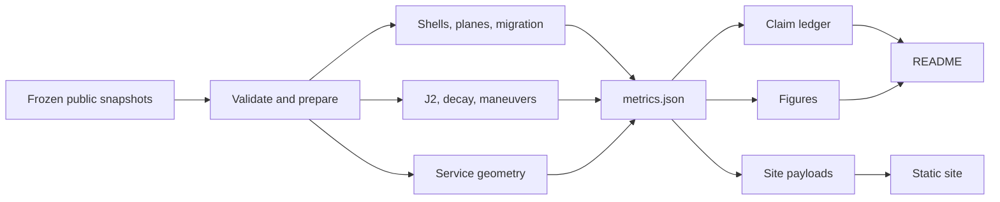

# Starlink Physical Atlas

**The public, reproducible measurement layer for the Starlink constellation.**

[](https://github.com/M0-AR/starlink-physical-atlas/actions/workflows/ci.yml)
[](LICENSE)
[](pyproject.toml)
[](https://m0-ar.github.io/starlink-physical-atlas/)

<a href="https://m0-ar.github.io/starlink-physical-atlas/"></a>

## Executive summary

Starlink dominates the active satellite catalog, yet many public descriptions rely on round numbers: "about 500 km", "thousands of satellites", "20 ms latency". This repository replaces those shorthands with a reproducible, open-data atlas built from three public snapshots. Every headline number is generated from `results/metrics.json`; every checkable statement is mapped to evidence in a 45-claim ledger. No result is hand-typed into this README.

The atlas is deliberately physical. It does not claim to reconstruct SpaceX's scheduler, beam plan, or end-to-end network. It measures what public orbital data can support: where the objects are, how the population changed, how the planes are arranged, how well J2 explains the geometry, how often a site could hand over, and what the radio path alone implies for latency.

> **Independent research artifact.** This project is not affiliated with, endorsed by, or connected to SpaceX or Starlink. It uses public catalog data and published references only.

**New here? Read the [🌱 Beginner guide — read this and you are a professional](#-beginner-guide--read-this-and-you-are-a-professional).**

## At a glance

| Quantity | Measurement |
|---|---|
| Starlink objects in the 2026-11-23 snapshot | **{{metrics.snapshots.nov2026.n|,}}** |
| Share of the active catalog | **{{metrics.active_catalog.share_pct|.2f}}%** ({{metrics.active_catalog.starlink|,}} of {{metrics.active_catalog.total|,}}) |
| Median altitude | **{{metrics.altitude.median_km|.1f}} km** (p05 {{metrics.altitude.p05_km|.1f}}, p95 {{metrics.altitude.p95_km|.1f}}) |
| Objects below 500 km | **{{metrics.altitude.pct_below_500|.2f}}%**; {{metrics.altitude.n_above_500}} at or above |
| Resolved altitude shells | **{{metrics.shells.n}}** across **{{metrics.shells.n_families}}** inclination families |
| Largest shell | **53.1° / 462.7 km**, n = {{metrics.shells.by_key.53p1_463.n|,}} |
| Median speed / period | **{{metrics.altitude.speed_median_kmh|,}} km/h** / **{{metrics.altitude.period_median_min|.2f}} min** |
| Median J2 prediction error | **{{metrics.j2.median_abs_rel_error_pct|.3f}}%** (p95 {{metrics.j2.p95_abs_rel_error_pct|.2f}}%) |
| Median visible satellites per site | **{{metrics.service.median_visible_p50|.1f}}** (range {{metrics.service.visible_p50_range.0}}–{{metrics.service.visible_p50_range.1}}) |
| Radio-only RTT bounds | **{{metrics.service.median_rtt_lower_p50_ms|.2f}}–{{metrics.service.median_rtt_upper_p50_ms|.2f}} ms** |
| SGP4 maximum position error | **{{metrics.sgp4_validation.max_pos_km|.3e}} km** over {{metrics.sgp4_validation.vectors_compared}} official vectors |

## Contents

- [Executive summary](#executive-summary)
- [At a glance](#at-a-glance)
- [Live demo](#live-demo)
- [Install and packages](#install-and-packages)
- [What this is — and what it is not](#what-this-is--and-what-it-is-not)
- [🌱 Beginner guide — read this and you are a professional](#-beginner-guide--read-this-and-you-are-a-professional)
- [Glossary](#glossary)
- [What you can do with it](#what-you-can-do-with-it)
- [What makes it different](#what-makes-it-different)
- [Why it matters](#why-it-matters)
- [Screenshots](#screenshots)
- [Interactive preview and accessibility](#interactive-preview-and-accessibility)
- [Key findings](#key-findings)
- [Data](#data)
- [Methods](#methods)
- [Validation summary](#validation-summary)
- [Reproducibility](#reproducibility)
- [Deployment on GitHub Pages](#deployment-on-github-pages)
- [FAQ](#faq)
- [Limitations](#limitations)
- [Claim ledger](#claim-ledger)
- [References](#references)
- [Artifact evaluation](#artifact-evaluation)
- [Project status and roadmap](#project-status-and-roadmap)
- [Press and media](#press-and-media)
- [Citation](#citation)
- [Collaboration](#collaboration)
- [Contributing, security, and conduct](#contributing-security-and-conduct)
- [Independence and license](#independence-and-license)

## Live demo

**Open the atlas:** <https://m0-ar.github.io/starlink-physical-atlas/>

The site runs entirely in the browser: no install, no account, no tracking. The landing page embeds seven working product views in lazy-loaded tabs, each with a full-screen path:

| View | What it answers |
|---|---|
| [Overview](https://m0-ar.github.io/starlink-physical-atlas/app/overview.html) | What is in the snapshot, and how strong is each claim? |
| [3D Atlas](https://m0-ar.github.io/starlink-physical-atlas/app/atlas.html) | Where are the objects, and how do the shells and planes fit together? |
| [Migration](https://m0-ar.github.io/starlink-physical-atlas/app/migration.html) | Which families moved, and by how much? |
| [Planes](https://m0-ar.github.io/starlink-physical-atlas/app/planes.html) | What does the effective orbital lattice look like? |
| [Service](https://m0-ar.github.io/starlink-physical-atlas/app/service.html) | What visibility, handover, Doppler, and radio latency does the geometry support? |
| [Learn](https://m0-ar.github.io/starlink-physical-atlas/app/learn.html) | Can a newcomer build the full mental model? |
| [Neural Orbit](https://m0-ar.github.io/starlink-physical-atlas/app/game.html) | Can you connect the concepts under time pressure? |


Prefer MP4? [Download the short tour](docs/assets/media/atlas-demo.mp4).

The interactive views use the same generated payloads as the static charts, so the browser cannot drift away from the measured tables. The 3D atlas is a two-body visualisation of mean elements; the scientific metrics come from the SGP4 pipeline.

## Install and packages

The atlas is a research artifact, a Python package, a static site, and a container. None of the options requires an account or a private service.

### Python

```bash
python3.12 -m venv .venv
. .venv/bin/activate
pip install -e ".[dev]"
make verify
```

Release wheels and source archives are attached to [GitHub Releases](https://github.com/M0-AR/starlink-physical-atlas/releases). The package name is `starlink-physical-atlas`; the import name is `atlas`.

### Container

```bash
docker build -t starlink-physical-atlas:1.0.0 .
docker run --rm starlink-physical-atlas:1.0.0 make verify
```

The container includes the frozen inputs, tests, and the site source. `make reproduce` runs the full pipeline inside it. The image is built from the repository `Dockerfile`, so no registry login is required.

### Static site

```bash
make site-data
python3 -m http.server 8765 --directory docs
```

Open <http://127.0.0.1:8765/>. The site is plain HTML, CSS, and ES modules. There is no package manager, no build step for the reader, and no tracking.

### What is in the package

- `atlas` — data preparation, geometry, dynamics, service, metrics, claims, paper, and site payload builders.
- `experiments/` — the numbered pipeline entry points.
- `configs/` — study settings, the claim ledger, references, and learning content.
- `data/raw/` — frozen public inputs with a SHA256 manifest.
- `results/` — metrics, tables, figures, and the rendered claim ledger.
- `docs/` — the complete static site, including the 3D atlas and Neural Orbit.

## What this is — and what it is not

| This is | This is not |
|---|---|
| A reproducible measurement of three public snapshots | Operator telemetry or a live operational feed |
| A physical model of shells, planes, migration, dynamics, and geometry | A reconstruction of SpaceX's scheduler, beams, or business plan |
| A claim ledger that states the strength of every checkable statement | A collision-warning or conjunction-assessment service |
| A radio-path latency bound with explicit gateway assumptions | An end-to-end internet latency measurement |
| An educational path from first principles to research vocabulary | An official Starlink or SpaceX publication |

## 🌱 Beginner guide — read this and you are a professional

You will know more than most interview candidates.

Let's work this out in a step-by-step way to be sure we have the right answer

The chain is short enough to hold in your head:

1. **A snapshot is a census at one epoch.** The catalog lists objects and their mean orbital elements, not a video of the sky.
2. **Mean motion gives altitude.** A faster orbit is lower. The atlas converts mean motion to a Keplerian altitude, then groups nearby altitudes into **shells**.
3. **Inclination gives a family.** A 43° orbit stays closer to the equator; a 97° orbit is polar and slightly retrograde. Families do not serve the same latitudes in the same way.
4. **RAAN gives a plane.** Two satellites with the same inclination but different RAAN are on different orbital rings. J2 slowly rotates those rings, so the atlas rectifies RAAN to a common epoch before counting **effective planes**.
5. **J2 is the predictable clock.** Earth's equatorial bulge makes the orbital plane precess. The observed drift matches the standard J2 prediction at the sub-percent level, which is why the rectification is credible.
6. **Visibility is not service.** A satellite above 25° elevation can be geometrically visible while beams, spectrum, load, and scheduling decide whether it can serve you.
7. **Radio latency is not internet latency.** The four-leg bent-pipe path alone is about 6 ms in the model. The 20–25 ms numbers people quote include far more than vacuum propagation.
8. **A claim needs a status.** "Verified", "consistent", "partially verified", and "external-only" are different epistemic states. The ledger keeps them separate.

The full 20-concept path, with diagrams, plain-language definitions, and links back to the evidence, is in the [Beginner guide](https://m0-ar.github.io/starlink-physical-atlas/app/learn.html). The [Neural Orbit game](https://m0-ar.github.io/starlink-physical-atlas/app/game.html) turns the same 20 concepts into four levels and a 3D concept graph.

## Glossary

| Term | Plain-language meaning |
|---|---|
| TLE | Two-Line Element set: a compact public description of an orbit at an epoch. |
| Epoch | The timestamp at which a TLE's mean elements are defined. |
| Mean element | An orbit-average value; useful for geometry, not a precise instantaneous position. |
| Shell | A cluster of satellites at a similar altitude. |
| Inclination family | A group with similar orbital tilt; families serve different latitudes. |
| Plane | An orbital ring, identified by RAAN within one inclination family. |
| RAAN | Right ascension of the ascending node: the plane's orientation around Earth's axis. |
| J2 | The dominant effect of Earth's equatorial bulge; it slowly precesses orbital planes. |
| Handover | A change in the satellite selected to serve a site. |
| Claim status | Verified, consistent, partially verified, external-only, contradicted, or not tested. |

## What you can do with it

| Audience | Useful question | Start here |
|---|---|---|
| Researchers and reviewers | Can these numbers be regenerated and audited? | [`make reproduce`](#reproducibility), [`results/CLAIMS.md`](results/CLAIMS.md) |
| Analysts and investors | Is the constellation one shell or a structured fleet, and how is it changing? | [Overview](https://m0-ar.github.io/starlink-physical-atlas/app/overview.html), [Migration](https://m0-ar.github.io/starlink-physical-atlas/app/migration.html) |
| Satellite operators and engineers | How coherent is the plane lattice, and what does J2 explain? | [Planes](https://m0-ar.github.io/starlink-physical-atlas/app/planes.html), [`docs/METHODS.md`](docs/METHODS.md) |
| Journalists and policy analysts | Which public claims survive contact with the data? | [Claim ledger](results/CLAIMS.md), [`docs/LIMITATIONS.md`](docs/LIMITATIONS.md) |
| Students and new engineers | What is a shell, a plane, RAAN, J2, or a handover? | [Beginner guide](https://m0-ar.github.io/starlink-physical-atlas/app/learn.html), [Neural Orbit](https://m0-ar.github.io/starlink-physical-atlas/app/game.html) |
| Educators | Can I use the visuals and the game in a class? | [Site](https://m0-ar.github.io/starlink-physical-atlas/), [figures](results/figures/), MIT/CC BY 4.0 terms |

The atlas is decision support, not investment advice and not an operational safety tool.

## What makes it different

- **Measured, not asserted.** Every headline number is rendered from `results/metrics.json`; the 45-claim ledger separates verified, consistent, partially verified, and external-only statements.
- **One evidence chain.** The charts, the 3D atlas, the game, the README, and the claim table all read the same generated payloads and frozen snapshot.
- **Honest about limits.** The project states what public mean elements cannot support: no gateway schedules, no beam plan, no operational latency, no collision warning.
- **Built for beginners and reviewers.** A plain-language path and a 3D quiz sit next to methods, validation tables, and reproducibility commands.
- **Local-first and accessible.** Static pages, keyboard tabs, reduced-motion support, WebGL fallbacks, no account, no tracking.
- **Reproducible by design.** Frozen inputs, SHA256 manifest, deterministic pipeline, tests, and a one-command rebuild.

### The 3D atlas

The atlas renders all {{metrics.snapshots.nov2026.n|,}} mean-element rows in the browser with Three.js. Colour encodes inclination family; shell rings show the resolved altitude groups; hover reveals altitude, inclination, RAAN, and family; the time control animates the two-body motion without pretending to be a live tracker.

### Neural Orbit

Neural Orbit is a four-level, twenty-question game built on the same `learning.json` payload as the beginner path. A 3D concept graph grows as you answer; correct answers unlock edges; a local speech synthesizer reads explanations; progress is stored in `localStorage`. It works without an account and without sending data anywhere.

## Why it matters

- **Due diligence and market analysis.** Replace round-number narratives with a distribution, a migration table, and an explicit uncertainty statement.
- **Research and review.** The methods, validation data, and claim ledger give reviewers something concrete to reproduce or challenge.
- **Education.** The beginner path and Neural Orbit make orbital mechanics, J2, handovers, and claim status teachable without a textbook-first approach.
- **Public communication.** Journalists and policy analysts can check a claim against the ledger instead of repeating an operator summary.
- **Space sustainability.** A reproducible physical atlas makes altitude, decay, and maneuver signatures easier to inspect over time.

## Screenshots


## Interactive preview and accessibility

The landing page embeds all seven product views as lazy iframes. On first visit only the active tab is fetched; switching tabs loads the selected page and keeps previously opened tabs warm. The fallback is a static poster with a direct link, so the page remains useful before the iframe arrives or when a browser blocks it.

- **Keyboard:** arrow keys, Home, and End move between tabs; the tablist follows the ARIA tabs pattern.
- **Motion:** the 3D views respect `prefers-reduced-motion`.
- **WebGL:** the atlas and game show a readable fallback if WebGL is unavailable.
- **No tracking:** no analytics, no cookies, no external font or script calls beyond the vendored libraries.
- **Small screen:** the layout collapses to a single column; the preview remains scrollable.

The seven full-screen pages are also listed in [`docs/app/all.html`](docs/app/all.html), with the whole map in [`README.md`](#repository-map).

## Research questions

1. **Population.** How many Starlink objects are in orbit, and how much of the active catalog do they represent?
2. **Geometry.** Is the constellation a single "550 km" shell, or a structured set of altitude and inclination families?
3. **Change.** Which shells migrated between 2025 and 2026, and by how much?
4. **Structure.** Are the orbital planes consistent with a small number of Walker sets, or with a more heterogeneous effective lattice?
5. **Dynamics.** Does J2 nodal regression explain the observed RAAN drift? What do mean elements say about orbit control and decay?
6. **Service.** How many satellites are visible above a 25° mask, how often would a best-satellite policy hand over, and what latency does the radio path alone imply?
7. **Reproducibility.** Can every claim be regenerated from frozen public data and tested code?

## Key findings

### 1. The catalog is large but not a single shell

On 2026-11-23 the CelesTrak Starlink GP snapshot contains **{{metrics.snapshots.nov2026.n|,}}** objects. The separate active catalog contains **{{metrics.active_catalog.total|,}}** objects, of which **{{metrics.active_catalog.starlink|,}}** are Starlink: **{{metrics.active_catalog.share_pct|.2f}}%**. The median altitude is **{{metrics.altitude.median_km|.1f}} km**, and **{{metrics.altitude.pct_below_500|.2f}}%** of objects are below 500 km. The public "550 km" shorthand describes the historical upper shell, not the median of the 2026 catalog.


*Figure 1. Starlink objects across the three public snapshots.*

### 2. The population resolves into 11 shells across 5 inclination families

A 2 km altitude histogram with a 25-object minimum and a ±8 km assignment window resolves **{{metrics.shells.n}}** shells and assigns **{{metrics.shells.n_assigned|,}}** of **{{metrics.snapshots.nov2026.n|,}}** objects (**{{metrics.shells.coverage_pct|.2f}}%**). The four largest operational shells dominate:

| Family | Shell | Objects | Median altitude | Median inclination |
|---|---:|---:|---:|---:|
| 43.0° | 483 km | {{metrics.shells.by_key.43_483.n|,}} | {{metrics.shells.by_key.43_483.alt_median_km|.1f}} km | {{metrics.shells.by_key.43_483.inc_median_deg|.4f}}° |
| 53.1° | 463 km | {{metrics.shells.by_key.53p1_463.n|,}} | {{metrics.shells.by_key.53p1_463.alt_median_km|.1f}} km | {{metrics.shells.by_key.53p1_463.inc_median_deg|.4f}}° |
| 70.0° | 475 km | {{metrics.shells.by_key.70_475.n|,}} | {{metrics.shells.by_key.70_475.alt_median_km|.1f}} km | {{metrics.shells.by_key.70_475.inc_median_deg|.4f}}° |
| 97.4° | 465 km | {{metrics.shells.by_key.97p4_465.n|,}} | {{metrics.shells.by_key.97p4_465.alt_median_km|.1f}} km | {{metrics.shells.by_key.97p4_465.inc_median_deg|.4f}}° |

Smaller deployment and transition shells remain: 30.5°/345 km ({{metrics.shells.by_key.30p5_345.n}}), 43.0°/351 km ({{metrics.shells.by_key.43_351.n|,}}), 53.1°/359 km ({{metrics.shells.by_key.53p1_359.n}}), 53.1°/449 km ({{metrics.shells.by_key.53p1_449.n}}), 53.1°/471 km ({{metrics.shells.by_key.53p1_471.n}}), 70.0°/363 km ({{metrics.shells.by_key.70_363.n}}), and 70.0°/525 km ({{metrics.shells.by_key.70_525.n}}). The {{metrics.altitude.n_above_500}} objects at or above 500 km are not a second dominant shell: {{metrics.altitude.above_500_bands.500_515}} lie at 500–515 km, {{metrics.altitude.above_500_bands.515_535}} at 515–535 km, {{metrics.altitude.above_500_bands.535_560}} at 535–560 km, and {{metrics.altitude.above_500_bands.560_plus}} at or above 560 km. The 70°/525 km shell is the largest coherent group in that tail; the highest points are individual 70° objects, not a resolved shell.


*Figure 2. Resolved shells in the 2026-11-23 snapshot. The constellation is a family of shells, not one altitude.*

### 3. Migration is shell-specific, not a global lowering

Pairing objects by normalized Starlink name across snapshots (the Kaggle tables do not carry NORAD IDs) shows that the 2025→2026 change is not one uniform "550→480 km" maneuver:

| Family | Apr 2026 → Nov 2026 | Matched | Median Δ altitude | Lowered >10 km | Stable within 10 km |
|---|---:|---:|---:|---:|---:|
| 43.0° | {{metrics.migration.by_family.apr2026_nov2026.43.alt_a_median_km|.1f}} → {{metrics.migration.by_family.apr2026_nov2026.43.alt_b_median_km|.1f}} km | {{metrics.migration.by_family.apr2026_nov2026.43.matched|,}} | {{metrics.migration.by_family.apr2026_nov2026.43.d_alt_median_km|+.1f}} km | {{metrics.migration.by_family.apr2026_nov2026.43.frac_lowered_gt10km|.1%}} | {{metrics.migration.by_family.apr2026_nov2026.43.frac_stable_10km|.1%}} |
| 53.1° | {{metrics.migration.by_family.apr2026_nov2026.53p1.alt_a_median_km|.1f}} → {{metrics.migration.by_family.apr2026_nov2026.53p1.alt_b_median_km|.1f}} km | {{metrics.migration.by_family.apr2026_nov2026.53p1.matched|,}} | {{metrics.migration.by_family.apr2026_nov2026.53p1.d_alt_median_km|+.1f}} km | {{metrics.migration.by_family.apr2026_nov2026.53p1.frac_lowered_gt10km|.1%}} | {{metrics.migration.by_family.apr2026_nov2026.53p1.frac_stable_10km|.1%}} |
| 70.0° | {{metrics.migration.by_family.apr2026_nov2026.70.alt_a_median_km|.1f}} → {{metrics.migration.by_family.apr2026_nov2026.70.alt_b_median_km|.1f}} km | {{metrics.migration.by_family.apr2026_nov2026.70.matched|,}} | {{metrics.migration.by_family.apr2026_nov2026.70.d_alt_median_km|+.1f}} km | {{metrics.migration.by_family.apr2026_nov2026.70.frac_lowered_gt10km|.1%}} | {{metrics.migration.by_family.apr2026_nov2026.70.frac_stable_10km|.1%}} |
| 97.4° | {{metrics.migration.by_family.apr2026_nov2026.97p4.alt_a_median_km|.1f}} → {{metrics.migration.by_family.apr2026_nov2026.97p4.alt_b_median_km|.1f}} km | {{metrics.migration.by_family.apr2026_nov2026.97p4.matched|,}} | {{metrics.migration.by_family.apr2026_nov2026.97p4.d_alt_median_km|+.1f}} km | {{metrics.migration.by_family.apr2026_nov2026.97p4.frac_lowered_gt10km|.1%}} | {{metrics.migration.by_family.apr2026_nov2026.97p4.frac_stable_10km|.1%}} |

The 43° shell is essentially stable; the 70° shell changed by about **{{metrics.migration.by_family.apr2026_nov2026.70.d_alt_median_km|+.0f}} km** for the matched population; the 53° shell shows a smaller, but broad, lowering; the 97° shell continues a multi-year descent. A single global "550→480" narrative loses these distinctions.


*Figure 3. Dominant-shell altitude history. Lines are resolved shells, not individual satellites.*

### 4. Plane structure is coherent but not one clean Walker set

Effective RAAN clustering after J2 rectification gives **{{metrics.planes.by_key.43_483.planes}}** groups at 43.0°/483 km, **{{metrics.planes.by_key.53p1_463.planes}}** at 53.1°/463 km, **{{metrics.planes.by_key.70_475.planes}}** at 70.0°/475 km, and **{{metrics.planes.by_key.97p4_465.planes}}** at 97.4°/465 km. The spacing is not uniform:

| Shell | Effective planes | Median spacing | Spacing CV | Median occupancy | Occupancy max |
|---|---:|---:|---:|---:|---:|
| 43.0° / 483 km | {{metrics.planes.by_key.43_483.planes}} | {{metrics.planes.by_key.43_483.spacing_median_deg|.2f}}° | {{metrics.planes.by_key.43_483.spacing_cv|.2f}} | {{metrics.planes.by_key.43_483.occupancy_median|.1f}} | {{metrics.planes.by_key.43_483.occupancy_max}} |
| 53.1° / 463 km | {{metrics.planes.by_key.53p1_463.planes}} | {{metrics.planes.by_key.53p1_463.spacing_median_deg|.2f}}° | {{metrics.planes.by_key.53p1_463.spacing_cv|.2f}} | {{metrics.planes.by_key.53p1_463.occupancy_median|.1f}} | {{metrics.planes.by_key.53p1_463.occupancy_max}} |
| 70.0° / 475 km | {{metrics.planes.by_key.70_475.planes}} | {{metrics.planes.by_key.70_475.spacing_median_deg|.2f}}° | {{metrics.planes.by_key.70_475.spacing_cv|.2f}} | {{metrics.planes.by_key.70_475.occupancy_median|.1f}} | {{metrics.planes.by_key.70_475.occupancy_max}} |
| 97.4° / 465 km | {{metrics.planes.by_key.97p4_465.planes}} | {{metrics.planes.by_key.97p4_465.spacing_median_deg|.2f}}° | {{metrics.planes.by_key.97p4_465.spacing_cv|.2f}} | {{metrics.planes.by_key.97p4_465.occupancy_median|.1f}} | {{metrics.planes.by_key.97p4_465.occupancy_max}} |

The 43° shell has moderate spacing irregularity; the 53° shell has a higher coefficient of variation, consistent with merged or partially filled planes; the 97° shell is the most heterogeneous. These are **effective** plane counts, not design Walker numbers. Mean-anomaly and twin-satellite metrics are contaminated where adjacent planes merge, so this atlas reports the lattice coherence rather than forcing a single Walker fit.


*Figure 4. Rectified RAAN spacing for the four largest shells.*

### 5. J2 nodal regression explains the geometry at the sub-percent level

For a 27-satellite panel with multi-year TLE histories, the observed RAAN slope agrees with the J2 prediction to **{{metrics.j2.median_abs_rel_error_pct|.3f}}%** at the median, **{{metrics.j2.p95_abs_rel_error_pct|.2f}}%** at p95, and **{{metrics.j2.max_abs_rel_error_pct|.2f}}%** at the maximum. The residual standard deviation is **{{metrics.j2.median_resid_std_deg|.3f}}°** at the median but rises to **{{metrics.j2.p95_resid_std_deg|.2f}}°** at p95. The bimodal residual distribution is itself a result: some satellites follow a clean secular J2 drift, while others show discontinuities consistent with plane changes or orbit-control campaigns.


*Figure 5. Observed versus J2-predicted RAAN drift.*

### 6. Orbit control and decay leave measurable signatures

Mean-element `ndot` gives a linearized decay signature. At 53.1°, **{{metrics.decay_by_family.53p1.frac_positive_ndot|.1%}}** of objects have positive `ndot` (a raising tendency), with a median semi-major-axis rate of **{{metrics.decay_by_family.53p1.da_dt_median_km_day|+.3f}} km/day** and an implied linear lifetime of **{{metrics.decay_by_family.53p1.life_median_yr|.1f}} years**. The 43° shell is much quieter ({{metrics.decay_by_family.43.da_dt_median_km_day|+.3f}} km/day; {{metrics.decay_by_family.43.life_median_yr|.0f}} years), while the 30.5° deployment group is short-lived by construction ({{metrics.decay_by_family.30p5.da_dt_median_km_day|+.3f}} km/day; {{metrics.decay_by_family.30p5.life_median_yr|.2f}} years). These are linearized indicators, not propagated lifetimes.

The TLE panel also contains **{{metrics.maneuvers.events}}** discrete orbit-control steps across **{{metrics.maneuvers.satellites}}** satellites ({{metrics.maneuvers.raises}} raises, {{metrics.maneuvers.lowers}} lowers). The public maneuver-count claim is far larger than this panel can test; the panel establishes that the signature is present and measurable, not that the operator's annual total is correct.


*Figure 6. Orbit-control steps and decay indicators.*

### 7. Service geometry is abundant, but handovers are frequent

A 10-site, 24-hour simulation at 15 s steps with a 25° elevation mask and **{{metrics.service.meta.n_satellites|,}}** satellites between 400 and 600 km finds a median of **{{metrics.service.median_visible_p50|.1f}}** visible satellites per site (range {{metrics.service.visible_p50_range.0}}–{{metrics.service.visible_p50_range.1}}). The median best-satellite handover interval is **{{metrics.service.median_handover_interval_s|.1f}} s** (p50 range {{metrics.service.handover_p50_range_s.0}}–{{metrics.service.handover_p50_range_s.1}} s), with a p90 median of **{{metrics.service.median_handover_p90_s|.1f}} s**. The radio-only four-leg RTT bounds are **{{metrics.service.median_rtt_lower_p50_ms|.2f}}–{{metrics.service.median_rtt_upper_p50_ms|.2f}} ms**, where the lower bound puts the gateway at nadir and the upper bound colocates it with the user.

| Service metric | Median | Range or extreme |
|---|---:|---:|
| Visible satellites (p50) | {{metrics.service.median_visible_p50|.1f}} | {{metrics.service.visible_p50_range.0}}–{{metrics.service.visible_p50_range.1}} |
| Handover interval (p50) | {{metrics.service.median_handover_interval_s|.1f}} s | {{metrics.service.handover_p50_range_s.0}}–{{metrics.service.handover_p50_range_s.1}} s |
| Handover interval (p90) | {{metrics.service.median_handover_p90_s|.1f}} s | — |
| RTT lower bound (p50) | {{metrics.service.median_rtt_lower_p50_ms|.2f}} ms | — |
| RTT upper bound (p50) | {{metrics.service.median_rtt_upper_p50_ms|.2f}} ms | — |
| Doppler p95 | {{metrics.service.median_doppler_p95_khz|.1f}} kHz | {{metrics.service.doppler_p95_range_khz.0}}–{{metrics.service.doppler_p95_range_khz.1}} kHz |
| Doppler-rate p95 | {{metrics.service.median_rate_p95_khz_s|.2f}} kHz/s | max {{metrics.service.rate_p95_max_khz_s|.2f}} kHz/s |
| Sites with rate p95 > 5 kHz/s | {{metrics.service.frac_sites_rate_gt_5|.1%}} | — |

This is a geometric service model, not an operational one. It ignores gateways, beams, scheduling, weather, and load. The 6 ms result is the radio path alone; it is not an end-to-end latency prediction and should not be compared directly with 20–25 ms public measurements.


*Figure 7. Visible-satellite count and handover behavior across ten sites.*

### 8. Launch cadence is stable at 26–27 satellites per launch

The snapshot contains **{{metrics.launches.n_satellites|,}}** objects from **{{metrics.launches.n_launches}}** launches. 2025 contributed **{{metrics.launches.sats_2025|,}}** satellites on **{{metrics.launches.launches_2025}}** launches; 2026 year-to-date contributed **{{metrics.launches.sats_2026|,}}** on **{{metrics.launches.launches_2026}}**. The per-launch median is **{{metrics.launches.per_launch.2025.median|.0f}}** in 2025 and **{{metrics.launches.per_launch.2026.median|.0f}}** in 2026, with **{{metrics.launches.per_launch.2025.frac_25_to_29|.1%}}** and **{{metrics.launches.per_launch.2026.frac_25_to_29|.1%}}** of launches carrying 25–29 satellites. **{{metrics.launches.first_3p5m_2026|,}}** still-on-orbit objects carry launch dates in the first 3.5 months of 2026.

### 9. Direct-to-cell and the 30.5° deployment group are distinct populations

The direct-to-cell subset contains **{{metrics.dtc.n_nov2026}}** objects in November 2026, **{{metrics.dtc.n_apr2026}}** in April 2026, and **{{metrics.dtc.n_apr2025}}** in April 2025. Its median altitude is **{{metrics.dtc.alt_median_nov2026_km|.1f}} km**; its median inclination fell from **{{metrics.dtc.inc_median_2025_deg|.2f}}°** in April 2025 to **{{metrics.dtc.inc_median_nov2026_deg|.1f}}°** in November 2026. The 30.5° group contains **{{metrics.v3_group.n}}** objects, with **{{metrics.v3_group.launch_days.2026_09_28}}** on 2026-09-28 and **{{metrics.v3_group.launch_days.2026_11_13}}** on 2026-11-13; its altitude median is **{{metrics.v3_group.alt_median_km|.1f}} km** and its full range is **{{metrics.v3_group.alt_min_km|.1f}}–{{metrics.v3_group.alt_max_km|.1f}} km**. This is a clean two-cohort deployment signature. The vehicle type behind it remains an external claim.

### 10. The catalog gains far more than it loses

Between April and November 2026 the catalog matched **{{metrics.population_flow.0.matched|,}}** objects, missed **{{metrics.population_flow.0.missing}}**, and added **{{metrics.population_flow.0.new|,}}** over **{{metrics.population_flow.0.months|.2f}}** months. That is **{{metrics.population_flow.0.missing_pct_per_month|.2f}}%** missing per month and **{{metrics.population_flow.0.new_per_month|.0f}}** new objects per month. Missing from a later catalog is not proof of decay: the SATCAT extract contains only on-orbit objects, so the atlas reports catalog attrition, not confirmed reentries.

## Data

All inputs are public. The frozen files, SHA256 digests, row counts, epochs, and licenses are in [`data/manifest.json`](data/manifest.json) and [`data/MANIFEST.md`](data/MANIFEST.md).

| Input | Rows | Epoch | Source | License |
|---|---:|---|---|---|
| Starlink GP snapshot | {{metrics.snapshots.nov2026.n|,}} | 2026-11-23 | CelesTrak | Public, attribution |
| Starlink snapshot | {{metrics.snapshots.apr2026.n|,}} | 2026-04-03 | Kaggle | CC BY-SA 4.0 |
| Starlink snapshot | {{metrics.snapshots.apr2025.n|,}} | 2025-04-11 | Kaggle | MIT |
| SATCAT extract | {{metrics.satcat.total|,}} | 2026-11-23 | CelesTrak | Public, attribution |
| Active catalog | {{metrics.active_catalog.total|,}} | 2026-11-23 | CelesTrak | Public, attribution |
| TLE history panel | {{metrics.j2.n_satellites}} satellites | 2024–2025 | CelesTrak | Public, attribution |

The 2026-04 Kaggle tables are derived from Starlink data and are distributed under CC BY-SA 4.0. Reuse of those tables must preserve the share-alike terms; the code and original prose here are MIT and CC BY 4.0 respectively. See [`LICENSE`](LICENSE).

**Availability.** Every input, processed table, metric, figure, claim, and site payload used in this README is in this repository. There is no private data, no API key, and no live service dependency. The only network-dependent step is the documented fetch script for reproducing the public downloads.

## Methods

### Propagation and validation

All orbital geometry is computed with the official `sgp4` Python implementation (`sgp4==2.27`). The implementation is checked against the reference vectors distributed with the package: **{{metrics.sgp4_validation.vectors_compared}}** vectors across **{{metrics.sgp4_validation.cases_with_vectors}}** cases, with **{{metrics.sgp4_validation.propagation_errors}}** declared propagation error. The maximum position difference is **{{metrics.sgp4_validation.max_pos_km|.3e}} km**, and the maximum velocity difference is **{{metrics.sgp4_validation.max_vel_km_s|.3e}} km/s**. The mean-motion altitude also agrees with SATCAT `(APOGEE+PERIGEE)/2` to a median of **{{metrics.satcat_altitude_check.median_abs_diff_km|.2f}} km** (p95 {{metrics.satcat_altitude_check.p95_abs_diff_km|.2f}} km, max {{metrics.satcat_altitude_check.max_abs_diff_km|.2f}} km).

### Shell resolution

Altitudes are computed from TLE mean motion with a Keplerian circular approximation. A 2 km histogram is built over the 2026-11-23 snapshot; peaks with at least 25 objects are retained; objects within ±8 km of a peak are assigned to that shell. The resulting shells are labeled by median inclination family. The procedure is deterministic and is implemented in `src/atlas/anatomy.py`; the full table is [`results/tables/anatomy_shells_nov2026.csv`](results/tables/anatomy_shells_nov2026.csv).

### Migration and population flow

Snapshots are joined by normalized Starlink name; the Kaggle tables do not carry NORAD IDs, so name matching is the cross-source key. A satellite is "lowered" if its altitude falls by more than 10 km, "raised" if it rises by more than 10 km, and "stable" otherwise. The identity `matched + new = later population` and `matched + missing = earlier population` is checked for each period. The full tables are [`results/tables/migration_apr2026_nov2026.csv`](results/tables/migration_apr2026_nov2026.csv), [`results/tables/migration_apr2025_apr2026.csv`](results/tables/migration_apr2025_apr2026.csv), and [`results/tables/population_flow.csv`](results/tables/population_flow.csv).

### Plane structure

RAAN is corrected for J2 nodal regression to a common reference epoch. Adjacent RAAN gaps are computed after sorting; the near-zero-gap fraction measures how often adjacent planes merge into one effective group. Plane counts are read from stable plateaus in the near-zero-gap fraction, not from a design database. Spacing CV and occupancy describe the effective lattice. The full table is [`results/tables/anatomy_planes_nov2026.csv`](results/tables/anatomy_planes_nov2026.csv).

### J2 fit

For each satellite in the TLE panel, RAAN is unwrapped and fitted against time. The observed slope is compared with the standard J2 nodal-regression prediction at the satellite's mean inclination and altitude. The fit uses only public mean elements; it does not estimate unmodeled forces or covariance. The full table is [`results/tables/j2_fit.csv`](results/tables/j2_fit.csv).

### Service and latency model

Ten sites (Munich, Berlin, Zurich, Vienna, Milan, Paris, London, Tromso, Longyearbyen, Singapore) are propagated for 24 hours at 15 s steps against the 2026-11-23 constellation, restricted to 400–600 km. A satellite is visible above a 25° elevation mask. The serving satellite is the one with the highest elevation; a handover is a change in that satellite. The radio path is a four-leg bent-pipe: user→satellite→gateway→satellite→user. The lower bound places the gateway at the sub-satellite point; the upper bound colocates it with the user. The model excludes fiber, processing, scheduling, weather, and load. The full outputs are [`results/tables/service_sites.csv`](results/tables/service_sites.csv), [`results/tables/service_meta.json`](results/tables/service_meta.json), and the compressed sample tables in `results/tables/`.

### Claim ledger

[`configs/claims.json`](configs/claims.json) stores each claim, its status, its measured template, its evidence pointers, and its reference keys. `experiments/06_claims.py` renders the templates against `results/metrics.json` and writes [`results/CLAIMS.md`](results/CLAIMS.md) and [`results/claims.csv`](results/claims.csv). An unknown template path is a hard error.

## Validation summary

| Check | Result |
|---|---|
| SGP4 official vectors | {{metrics.sgp4_validation.vectors_compared}} compared; max {{metrics.sgp4_validation.max_pos_km|.3e}} km |
| Mean-motion altitude vs SATCAT | median {{metrics.satcat_altitude_check.median_abs_diff_km|.2f}} km; p95 {{metrics.satcat_altitude_check.p95_abs_diff_km|.2f}} km |
| J2 RAAN prediction | median {{metrics.j2.median_abs_rel_error_pct|.3f}}%; p95 {{metrics.j2.p95_abs_rel_error_pct|.2f}}% |
| Population identity | holds for both comparison periods |
| Service propagation errors | {{metrics.service.meta.sgp4_error_rate|.1%}} |
| Test suite | `pytest` (see `tests/`) |

## Reproducibility

```bash
python3.12 -m venv .venv
. .venv/bin/activate
pip install -e .
make reproduce
make test
```

`make reproduce` runs the full pipeline: SGP4 validation, anatomy, service simulation, dynamics, metrics, figures, the claim ledger, and the README render. The frozen inputs are already in `data/raw/`; `scripts/fetch_data.sh` documents how they were obtained. The pipeline writes `results/metrics.json` and `README.md`. A clean run should reproduce the numbers in this document.

To verify without rerunning the simulation:

```bash
make verify
```

This checks the manifest, the claim ledger, the paper renderer, and the test suite.

### Run the website locally

The site is static and has no build step for the reader:

```bash
make site-data
python3 -m http.server 8765 --directory docs
```

Open <http://127.0.0.1:8765/>. The server is required because the pages fetch JSON and load ES modules; opening `docs/index.html` directly from disk will not work in most browsers.

## Deployment on GitHub Pages

The published site is served from the `docs/` folder on the `main` branch:

1. Open **Settings → Pages**.
2. Set **Source** to **Deploy from a branch**.
3. Choose branch **main** and folder **/docs**, then save.
4. The site appears at <https://m0-ar.github.io/starlink-physical-atlas/>.

`docs/.nojekyll` tells Pages to serve the folder as static HTML. `docs/index.html` is the entry point; `docs/preview.html` is a stable alias that redirects to `docs/index.html#preview`. All links are relative, so the site also works from a fork or a local static server. No Actions deployment is required.

If you use a custom domain, add a `docs/CNAME` file and configure the domain in the same Pages settings panel.

### Pipeline architecture



### Repository map

```text
docs/                 static GitHub Pages site and browser payloads
  index.html          landing page with seven live preview tabs
  preview.html        alias that redirects to the live preview
  app/                overview, atlas, migration, planes, service, learn, game
  assets/             CSS, JavaScript, 3D vendor files, posters, screenshots
  data/               generated atlas.json, satellites.json, learning.json
src/atlas/            data, geometry, dynamics, service, template, paper, site
experiments/          numbered pipeline entry points, including site data
configs/              study settings, claim ledger, learning content, references
data/raw/             frozen public inputs
data/processed/       reproducible processed snapshot
results/              metrics, tables, figures, rendered claims
paper/                README source of truth
tests/                pipeline, claims, README, and site contract tests
```

## FAQ

**Is this an official Starlink source?** No. It is independent research built from public catalog data. It is not affiliated with SpaceX.

**Why is the median altitude 465.5 km when the public shorthand is 550 km?** The 550 km description refers to a historical upper shell. The 2026 catalog is dominated by several lower operational shells, so the population median is lower. The atlas reports the distribution, not a single slogan.

**Why does the atlas say 6 ms when people quote 20–25 ms?** The 6.19–6.27 ms figure is the four-leg radio path alone, with the gateway at one of two explicit extremes. It excludes fiber, routing, processing, scheduling, weather, and load. It is not a user-observed internet latency.

**Why are the plane counts not Walker numbers?** The counts are effective RAAN clusters after J2 rectification. They describe the observed lattice, not a design database. Adjacent planes merge in the projection, so the atlas reports coherent effective groups and the spacing statistics that support them.

**Why does the snapshot contain 11,198 objects while the active catalog reports 11,199 Starlink objects?** The two files are different catalog products with different filters and epochs. The atlas reports both and does not force them to agree; the comparison is documented in `results/metrics.json`.

**Why are some famous claims marked external-only?** Spacecraft mass, thrusters, laser terminals, launch vehicle type, and operator maneuver totals are not recoverable from a public mean-element snapshot. They remain external claims, with references, rather than measurements of this study.

**Can I use the figures and the game in a class or an article?** Yes, with attribution. Code is MIT, prose is CC BY 4.0, and the April 2026 derived tables retain CC BY-SA 4.0. See [`LICENSE`](LICENSE) and [`data/MANIFEST.md`](data/MANIFEST.md).

**How do I check one headline number?** Open [`results/CLAIMS.md`](results/CLAIMS.md) for the claim status and evidence pointers, then inspect [`results/metrics.json`](results/metrics.json) and the generated table that feeds it. The README renderer fails on an unknown placeholder or a missing figure.

**Does the site use live satellite positions?** No. It uses the frozen 2026-11-23 snapshot. The 3D view animates mean elements to make the geometry legible; it is not a live tracker and not a precision propagator.

## Limitations

- **Snapshot, not census.** The atlas describes three public snapshots. Objects that are missing from a later catalog are reported as catalog attrition, not confirmed decay.
- **Mean elements, not precision orbit determination.** TLEs carry round-off and fitting error. The atlas does not estimate covariance or probability of collision.
- **No gateway coordinates.** Latency is a radio-only bounding box, not an end-to-end route. The 6 ms result must not be presented as user-observed latency.
- **No scheduler or beam model.** Visibility and handover are geometric. Operational handovers may be constrained by beams, spectrum, load, and policy.
- **Effective planes.** Plane counts are RAAN clusters after J2 rectification, not design Walker numbers. Merged planes contaminate mean-anomaly and twin metrics, so those are not used for strong claims.
- **External claims.** Spacecraft mass, thrusters, laser terminals, terminal hardware, launch vehicle type, and operator maneuver totals are marked `external_only` or `partially_verified` in the ledger. They are not measurements of this study.
- **The 500 km tail.** {{metrics.altitude.n_above_500}} objects are at or above 500 km: {{metrics.altitude.above_500_bands.500_515}} at 500–515 km, {{metrics.altitude.above_500_bands.515_535}} at 515–535 km, {{metrics.altitude.above_500_bands.535_560}} at 535–560 km, and {{metrics.altitude.above_500_bands.560_plus}} at or above 560 km (maximum {{metrics.altitude.max_km|.1f}} km). This includes the 70°/525 km shell; the highest points are individual 70° objects, not a resolved shell. The "about 500 km" description is a population summary, not a hard ceiling.
- **No live operational data.** The atlas does not ingest telemetry, gateway schedules, or user terminals.

## Claim ledger

The ledger contains **{{claims.total}}** claims: **{{claims.verified}}** verified, **{{claims.consistent}}** consistent, **{{claims.partially_verified}}** partially verified, **{{claims.external_only}}** external-only, **{{claims.contradicted}}** contradicted, and **{{claims.not_tested}}** not tested. It cites **{{claims.cited_references}}** of the **{{claims.references_total}}** references in the bibliography.

Start with [`results/CLAIMS.md`](results/CLAIMS.md) for the full table. The CSV is [`results/claims.csv`](results/claims.csv).

## References

{{references_md}}

## Artifact evaluation

This repository is structured for the ACM artifact-review workflow:

- **Available.** Public data, frozen inputs, manifest, and source are in the repository.
- **Functional.** `make reproduce` regenerates metrics, figures, README, and the claim ledger; `make test` runs the test suite.
- **Reusable.** Modules are separated into data, geometry, anatomy, dynamics, service, and template layers; `configs/study.yaml` records the study parameters.
- **Results reproduced.** The claim ledger and validation tables state which results are measured here and which are external.

See [`docs/REVIEW_CHECKLIST.md`](docs/REVIEW_CHECKLIST.md) for the reviewer walkthrough. Detailed methods, validation evidence, and limitations are in [`docs/METHODS.md`](docs/METHODS.md), [`docs/VALIDATION.md`](docs/VALIDATION.md), and [`docs/LIMITATIONS.md`](docs/LIMITATIONS.md).

## Project status and roadmap

**Status:** v1.0.0, public research artifact. The data, code, tests, site, claim ledger, and README are complete for the 2026-11-23 snapshot. Maintenance is best-effort; corrections with evidence take priority.

| Track | Next step | Why |
|---|---|---|
| Data | Add new public snapshots when available | Test whether the 11-shell structure persists |
| Identity | Add NORAD joins if a licensed crosswalk becomes available | Replace name matching with a stronger key |
| Service | Add public gateway coordinates | Turn the radio bound into a routed bound |
| Accessibility | Expand screen-reader and keyboard QA | Keep the educational path open to more people |
| Education | Add classroom worksheets and answer keys | Make the atlas easier to teach |
| Packaging | Publish signed release artifacts and a container SBOM | Improve supply-chain transparency |

**Not planned:** live tracking, operational collision warnings, interference, or any use that targets spacecraft.

## Press and media

- **Press kit:** [`docs/PRESS_KIT.md`](docs/PRESS_KIT.md) has boilerplate, key facts, and asset links.
- **Social card:** [`docs/assets/social-card.png`](docs/assets/social-card.png) (1200×630).
- **Screenshots:** [`docs/assets/screenshots/`](docs/assets/screenshots/).
- **Logo mark:** [`docs/assets/favicon.svg`](docs/assets/favicon.svg).
- **Contact:** open a GitHub issue titled `Press:` or use the repository's private security advisory for confidential matters.

Please preserve the independence statement: this project is not affiliated with SpaceX or Starlink.

## Citation

If you use this atlas, cite the repository and the underlying public data sources. A `CITATION.cff` is provided. The bibliography above lists the papers used for external claims and context.

```bibtex
@misc{starlink_physical_atlas_2026,
  title        = {Starlink Physical Atlas: reproducible measurements of the 2025--2026 constellation},
  author       = {M0-AR},
  year         = {2026},
  howpublished = {https://github.com/M0-AR/starlink-physical-atlas},
  note         = {Open-data physical atlas; MIT code, CC BY 4.0 prose}
}
```

## Collaboration

The atlas is designed to be extended, reviewed, and taught. Useful collaborations include:

- **Data corrections:** a new snapshot, a better name crosswalk, or a documented catalog change.
- **Independent review:** reproduce a metric, challenge an interpretation, or add a validation check.
- **Classroom use:** adapt the beginner path, the 3D atlas, or Neural Orbit for a course.
- **Methods:** gateway-aware latency, covariance, or a stronger plane estimator with public inputs.
- **Media:** use the press kit and preserve the independence statement.

Open an issue before a large change. For commercial reuse, the code is MIT and the prose is CC BY 4.0; the April 2026 derived tables remain CC BY-SA 4.0.

## Contributing, security, and conduct

Contributions that improve measurement quality, clarity, accessibility, or reproducibility are welcome. Start with [`CONTRIBUTING.md`](CONTRIBUTING.md), open an issue before a large change, and run `make verify` before a pull request. Do not add operational interference, private data, or unverified headline numbers.

- **Security:** report vulnerabilities privately as described in [`SECURITY.md`](SECURITY.md). This project has no server component and no credentials.
- **Conduct:** participation is governed by [`CODE_OF_CONDUCT.md`](CODE_OF_CONDUCT.md).
- **Data corrections:** include the source, epoch, and evidence path. A claim change must update the ledger, the generated README, and the tests together.
- **Site changes:** keep the static site accessible, keep every preview interactive, and do not hand-edit generated JSON.

## Independence and license

This is an independent, non-commercial research artifact. It uses public catalog data and does not attempt to contact, interfere with, or reverse-engineer operational systems. The code is MIT licensed; the prose is CC BY 4.0; the April 2026 derived tables retain CC BY-SA 4.0. Attribution and share-alike obligations are documented in [`LICENSE`](LICENSE) and [`data/MANIFEST.md`](data/MANIFEST.md).

The space-sustainability framing is intentional: a reproducible physical atlas makes it easier to check claims about altitude, decay, and maneuver activity without relying on operator summaries alone.
